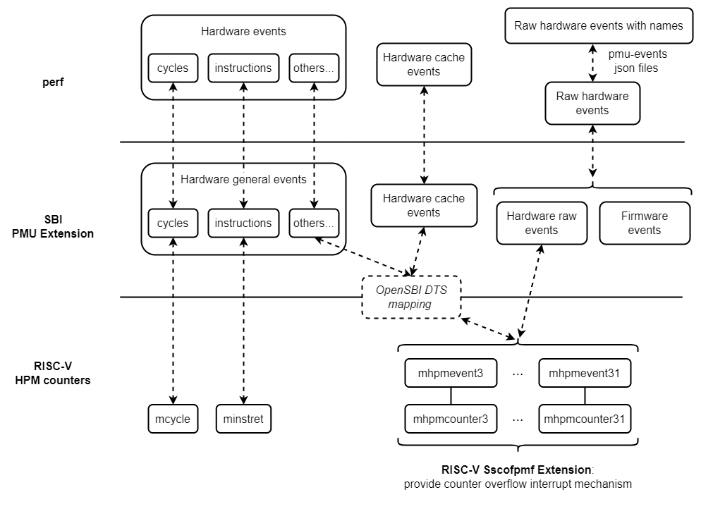
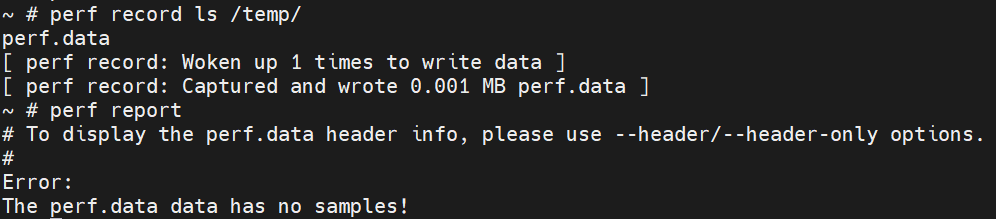
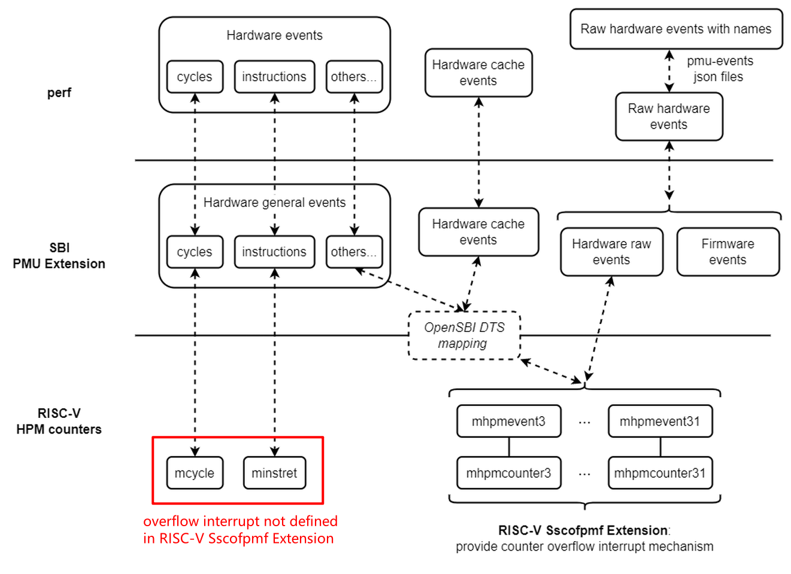
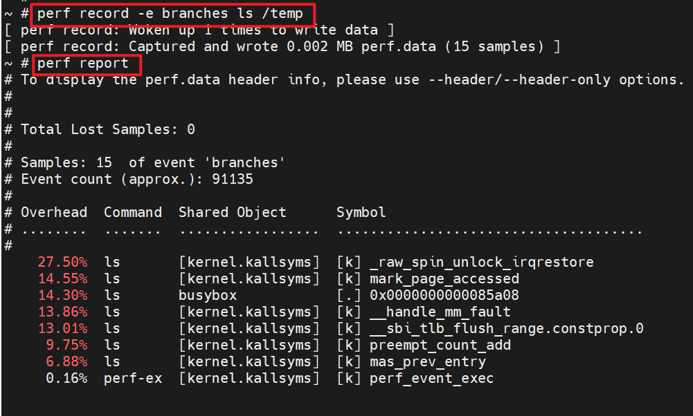
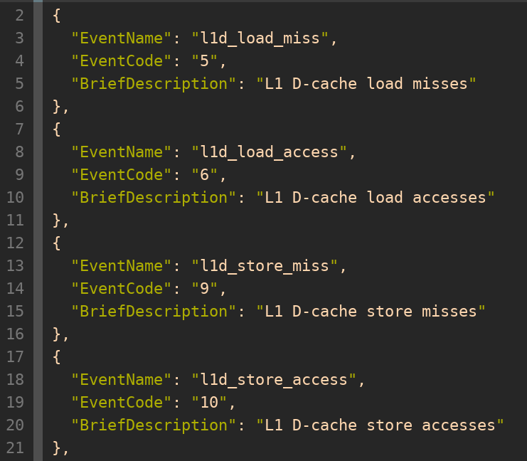
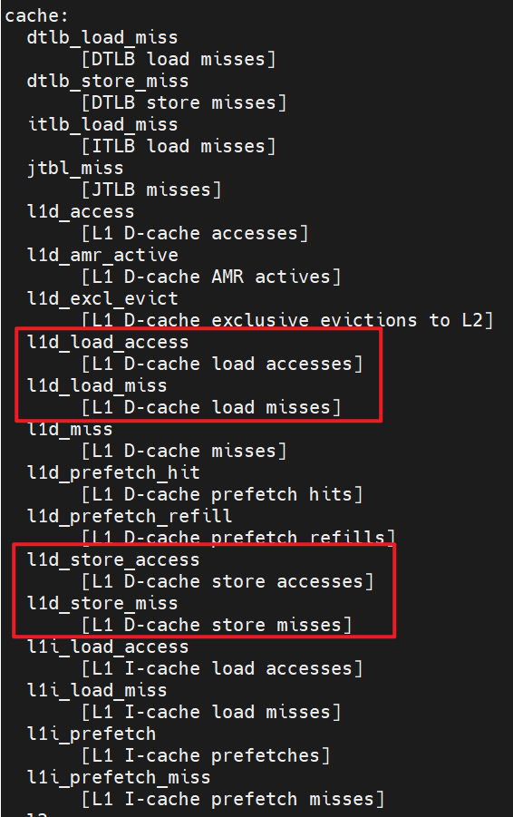
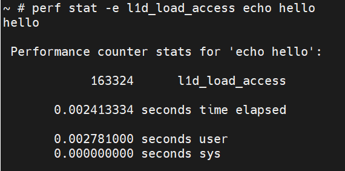

# Perf Usage Notes

(For basic perf usage, see the [official tutorial](https://perf.wiki.kernel.org/index.php/Tutorial). This document does not cover it.)

Current perf support on RISC-V involves the following software and hardware frameworks and specifications:

- Linux perf framework
  - The perf core framework
  - The pmu-events JSON files of the perf tool, which let perf select platform-specific hardware events by name instead of by raw encoding
- SBI PMU Extension
- RISC-V hardware specifications
  - Hardware Performance Monitor (HPM) as defined in the RISC-V ISA Privileged Specification
  - Sscofpmf Extension

The following figure shows how they relate:



Even when the software and hardware support all of the above, perf users should be aware of the issues described below.

## How Events Map to Hardware

The "Hardware event" and "Hardware cache event" entries listed by `perf list` are hardware event names predefined by the Linux perf framework. On RISC-V, they are linked to the physical HPM counters through the SBI PMU Extension. In the OpenSBI implementation of the PMU Extension, this mapping is described in the Device Tree node with `compatible = "riscv,pmu"`:

- `riscv,event-to-mhpmevent`: perf event number → selector written to the `mhpmevent` CSR
- `riscv,event-to-mhpmcounters`: event number range → counters the events are allowed to use (bitmap)
- `riscv,raw-event-to-mhpmcounters`: raw selector → counters the selector is allowed to use (bitmap)

For a detailed description of the format, see [docs/pmu_support.md](https://github.com/riscv-software-src/opensbi/blob/master/docs/pmu_support.md) in the OpenSBI source tree.

**This Device Tree content is parsed by OpenSBI and is not visible to the Linux perf framework** (no relevant specification currently exists). As a result:

- not every hardware event listed by `perf list` corresponds to an actual HPM event;
- the same selector can represent different events on different core models.

The event tables differ between cores. The X60 and X100 mappings are described in the following sections.

## Not All Hardware Events Listed by `perf list` Are Available

**Symptoms:**

On older versions of perf, `perf list` shows every event predefined by the framework, regardless of whether the current platform supports it. For example:

```shell
$ perf list | grep Hardware
  branch-instructions OR branches                    [Hardware event]
  branch-misses                                      [Hardware event]
  bus-cycles                                         [Hardware event]
  cache-misses                                       [Hardware event]
  cache-references                                   [Hardware event]
  cpu-cycles OR cycles                               [Hardware event]
  instructions                                       [Hardware event]
  ref-cycles                                         [Hardware event]
  stalled-cycles-backend OR idle-cycles-backend      [Hardware event]
  stalled-cycles-frontend OR idle-cycles-frontend    [Hardware event]
  ...
  dTLB-load-misses                                   [Hardware cache event]
  dTLB-loads                                         [Hardware cache event]
  iTLB-load-misses                                   [Hardware cache event]
  iTLB-loads                                         [Hardware cache event]
  LLC-load-misses                                    [Hardware cache event]
  ...
```

Many of these events may not be supported on the current platform.

**Causes:**

As explained in the previous section, the mapping between events and hardware is described in the Device Tree and parsed by OpenSBI, so the perf tool cannot tell whether the firmware defines a given event. Newer versions of perf (Linux 6.0 and later) try to open each event before listing it and omit the events that fail to open. Older versions do not perform this check.

**How to Verify and Interpret the Results:**

To distinguish these cases, check how `perf stat` reports the event:

| Result | Meaning | Action |
|---|---|---|
| The event does not appear in `perf list` | This perf version has already probed the event, or the firmware defines no mapping for it | Specify the event by its raw selector (see "How to Use Raw Hardware Events"), or check the firmware version |
| `<not supported>` | The event failed to open because SBI rejected it | Same as above |
| `<not counted>` | The event opened successfully, but its enabled/running time is 0 | Usually, more events are being counted than there are available counters, and this event was multiplexed out. Reduce the number of events counted at the same time |
| A percentage below 100% after the event name | The counter was multiplexed, and the count is extrapolated from the time the event was active | The lower the percentage, the more the count may vary |

> `<not supported>` and `<not counted>` are reported at different stages: `<not supported>` means the event was rejected when it was opened, while `<not counted>` means the event opened successfully but nothing was counted.

## X60

### Events and Counters

The X60 Device Tree mapping is as follows:

```dts
pmu {
    compatible = "riscv,pmu";

    riscv,event-to-mhpmevent =
    /* BRANCH_INSTRUCTIONS */
    <0x00005 0x0 0x01>,
    /* BRANCH_MISSES */
    <0x00006 0x0 0x02>,
    /* STALLED_CYCLES_FRONTEND */
    <0x00008 0x0 0x03>,
    /* STALLED_CYCLES_BACKEND */
    <0x00009 0x0 0x04>,
    /* L1D_READ_ACCESS */
    <0x10000 0x0 0x06>,
    /* L1D_READ_MISS */
    <0x10001 0x0 0x05>,
    /* L1D_WRITE_ACCESS */
    <0x10002 0x0 0x0a>,
    /* L1D_WRITE_MISS */
    <0x10003 0x0 0x09>,
    /* L1I_READ_ACCESS */
    <0x10008 0x0 0x0c>,
    /* L1I_READ_MISS */
    <0x10009 0x0 0x0b>,
    /* L1I_PREFETCH_ACCESS */
    <0x1000c 0x0 0x0e>,
    /* L1I_PREFETCH_MISS */
    <0x1000d 0x0 0x0d>,
    /* DTLB_READ_MISS */
    <0x10019 0x0 0x15>,
    /* DTLB_WRITE_MISS */
    <0x1001b 0x0 0x19>,
    /* ITLB_READ_MISS */
    <0x10021 0x0 0x1b>;

    /* 16 valid counters: mhpmcounter3 ~ mhpmcounter18 */
    riscv,event-to-mhpmcounters =
     <0x00005 0x00006 0x0007fff8>,
     <0x00008 0x00009 0x0007fff8>,
     <0x10000 0x10003 0x0007fff8>,
     <0x10008 0x10009 0x0007fff8>,
     <0x1000c 0x1000d 0x0007fff8>,
     <0x10019 0x10019 0x0007fff8>,
     <0x1001b 0x1001b 0x0007fff8>,
     <0x10021 0x10021 0x0007fff8>;

    riscv,raw-event-to-mhpmcounters =
     /*
      * For convenience, we treat 0x1~0xff as valid indexes,
      * but actually in hardware the valid indexes are 0x1~0xbd.
      */
     <0x0 0x0 0xffffffff 0xffffff00 0x0007fff8>;
};
```

X60 has 16 programmable counters, `mhpmcounter3` to `mhpmcounter18`. Each of the events above can use any of them.

### `perf record` and Other Sampling Features Do Not Work for `cycles` and `instructions`

**Symptoms:**

On X60, perf features that sample hardware events (including but not limited to `perf record` and `perf top`) do not work for the `cycles` and `instructions` events. Possible symptoms include:

- After you run `perf record`, running `perf report` on the generated `perf.data` fails with "The perf.data data has no samples!":

  

- `perf top` produces no output.

**Causes:**

To sample a hardware event, perf features such as `record` and `top` require the hardware counter for that event to support overflow interrupts. The RISC-V Sscofpmf extension defines how the `mhpmevent` counters provide overflow interrupts.

However, Sscofpmf does not define overflow interrupts for `mcycle` and `minstret`, the counter CSRs used by the `cycles` and `instructions` events, and X60 provides no additional handling for them. As a result, perf sampling features do not work for these two events:



In most cases, perf counts the `cycles` event by default when no event is specified with `-e`. **Therefore, on X60 it is expected that sampling features produce no output, or report 0 samples, by default. This does not mean that perf is unusable: specify another event with `-e` instead.** For example:



When using sampling to analyze performance on X60, consider the following alternatives to `cycles` and `instructions`:

- Software events such as `cpu-clock` and `task-clock`.
- Specific events supported by the X60 hardware, such as U/S/M-mode cycle counts and counts of specific instruction types. For details on these events, refer to the hardware manual. For how to use them in perf, see "How to Use Raw Hardware Events" below.

## X100

### Events and Counters

The X100 Device Tree mapping differs from X60 in the following ways:

- `cycles` and `instructions` are fixed to `mhpmcounter17` and `mhpmcounter18`, respectively;
- the `stalled-cycles-frontend` / `stalled-cycles-backend` events and the L1I prefetch events are removed;
- L1D prefetch events and DTLB access events are added.

| perf event name | Event number | Selector | Counters used |
|---|---|---|---|
| cycles | 0x00001 | 0x1e | mhpmcounter17 |
| instructions | 0x00002 | 0x1f | mhpmcounter18 |
| branches | 0x00005 | 0x01 | shared |
| branch-misses | 0x00006 | 0x02 | shared |
| L1-dcache-loads | 0x10000 | 0x06 | shared |
| L1-dcache-load-misses | 0x10001 | 0x05 | shared |
| L1-dcache-stores | 0x10002 | 0x0a | shared |
| L1-dcache-store-misses | 0x10003 | 0x09 | shared |
| L1-dcache-prefetches | 0x10004 | 0x08 | shared |
| L1-dcache-prefetch-misses | 0x10005 | 0x07 | shared |
| L1-icache-loads | 0x10008 | 0x0c | shared |
| L1-icache-load-misses | 0x10009 | 0x0b | shared |
| dTLB-loads | 0x10018 | 0x16 | shared |
| dTLB-stores | 0x1001a | 0x1a | shared |
| dTLB-store-misses | 0x1001b | 0x19 | shared |
| iTLB-load-misses | 0x10021 | 0x1b | shared |

"shared" means the event can use any of the 14 counters from `mhpmcounter3` to `mhpmcounter16`. X100 can therefore count at most 14 general events at the same time; `cycles` and `instructions` do not count toward this limit. Any additional events are multiplexed.

The following events have no mapping on X100 and cannot be specified by name: `bus-cycles`, `ref-cycles`, `cache-references`, `cache-misses` (LLC), `stalled-cycles-frontend`, `stalled-cycles-backend`, `L1-icache-prefetches`, `L1-icache-prefetch-misses`, `dTLB-load-misses`, and `iTLB-loads`. Of these, `dTLB-load-misses` can be counted with the raw selector `0x15` instead (see below).

### Sampling

X100 advertises Sscofpmf, and `cycles` and `instructions` use ordinary programmable counters rather than `mcycle` and `minstret`. As a result, sampling features such as `perf record` and `perf top` also work for these two events, unlike on X60.

If the chip also contains cores of other models, the whole system shares a single Device Tree. The event table therefore still follows X100, and perf does not interpret events differently per core. For accurate results, pin the process under test to an X100 core with `taskset`. When counting across cores with `perf stat -A`, interpret the counts from non-X100 cores separately.

## How to Use Raw Hardware Events

The Linux perf framework predefines names for only some hardware events. Events that the hardware supports but that have no predefined name are called raw hardware events. You can specify them with `-e` in either of the following ways:

- By `rNNN` encoding.
- By name (requires the platform SDK to provide pmu-events JSON files).

### By `rNNN` Encoding

`-e rNNN` specifies an event directly by its hardware-defined selector, where `NNN` is a hexadecimal number without the `0x` prefix.

On RISC-V platforms that support the SBI PMU Extension, `NNN` is the selector written to the `mhpmevent` CSR:

```plain
  [63:48]   must be 0
  [47:0]    mhpmevent selector
```

For example, to count the event whose selector is `0x15`, use `-e r15`.

> Do not use the `r0400000000000008` form, which encodes `PERF_TYPE_RAW` in the upper bits. The perf tool passes the event type in `attr.type`, so `config` should contain only the selector. If the upper bits are not 0, newer kernels reject the event, while older kernels silently use only the lower 48 bits.

In addition, **not every selector can be used**. Only selectors permitted by the firmware in `riscv,raw-event-to-mhpmcounters` can be opened.

- X60 permits `0x1` to `0xff` (the selectors actually valid in hardware are `0x1` to `0xbd`).
- X100 permits the following 47 selectors: `01 02 05 06 07 08 09 0a 0b 0c 10 11 12 13 14 15 16 17 18 19 1a 1b 1e 1f 20 21 22 24 25 26 27 28 29 2b 2d 32 33 34 35 36 37 38 3a 3b 3c 3d 3f`.

The `dTLB-load-misses` event mentioned earlier is one such case: the X100 Device Tree defines no name mapping for it, but selector `0x15` is permitted, so it can be counted with `-e r15`.

### By Name

The perf tool lets vendors add JSON files to its source tree to define names for their raw hardware events. You can then specify these events by name instead of by `rNNN` encoding.

If a platform implements this, the JSON files are located in `tools/perf/pmu-events/arch/riscv/` in the Linux source tree of its SDK. For example, X60 provides:

```shell
user@host:~/linux/tools/perf/pmu-events/arch/riscv$ tree spacemit/x60
spacemit/x60
|-- branch.json
|-- cache.json
|-- instruction.json
`-- microarch.json
```

When you **use perf built from this source tree**, you can use the names defined in these JSON files instead of `rNNN` encodings.

The following excerpt from the X60 `cache.json` is an example:



- `EventName` is the name to use with the perf `-e` option.
- `EventCode` is the number of the HPM event in the hardware manual.

These names appear in `perf list`. If the output is too long, list only the events that match a keyword, for example `perf list l1`:



You can use the name directly with `-e`, for example:



If the current SDK does not provide JSON files for the platform, only `rNNN` encoding is available.
