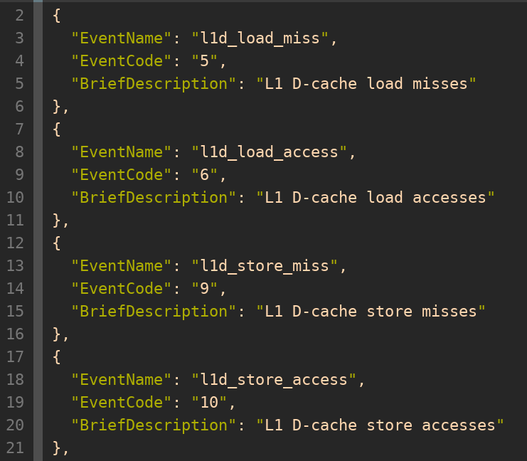
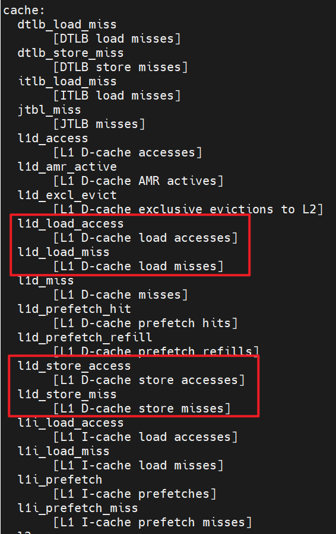

# Perf 使用注意事项

（perf 工具的基本用法可参考[官方教程](https://perf.wiki.kernel.org/index.php/Tutorial)，本文不再涉及。）

当前 RISC-V 对 perf 的支持涉及以下软/硬件的框架/规范：

- Linux perf 框架
  - perf 框架主体
  - perf 工具的 pmu-events json 文件（允许 perf 工具以名字而非 raw 编码指定硬件平台所支持的特定事件）
- SBI PMU Extension
- RISC-V 硬件规范
  - RISC-V ISA Privileged Specification 中定义的 HPM（Hardware Performance Monitor）内容
  - Sscofpmf Extension

它们的关系如下：


但即使软/硬件上全都支持了以上内容，仍存在以下事项需 perf 的使用者关注。

## 事件如何映射到硬件

`perf list` 列出的 “Hardware event” 和 “Hardware cache event” 是 Linux perf 框架中预设好的硬件事件名字，在 RISC-V 平台中它们是通过 SBI PMU Extension 与实际的 HPM 硬件计数器建立起联系的。而在 OpenSBI 的 PMU Extension 实现中，这种映射关系描述在 Device Tree 中 `compatible = "riscv,pmu"` 的节点里：

- `riscv,event-to-mhpmevent`：perf 的事件号 → 写进 `mhpmevent` 寄存器的选择子
- `riscv,event-to-mhpmcounters`：事件号范围 → 允许使用哪些计数器（位图）
- `riscv,raw-event-to-mhpmcounters`：raw 选择子 → 允许使用哪些计数器（位图）

具体的格式说明可参考 OpenSBI 源码中的文档 [docs/pmu_support.md](https://github.com/riscv-software-src/opensbi/blob/master/docs/pmu_support.md) 。

**Device Tree 的这些内容，是由 OpenSBI 解析，Linux perf 框架无法得知**（目前没有定义相关的规范）。因此：

- `perf list` 所列出的硬件事件，并非每一个都对应硬件上实际的 HPM 事件；
- 同一个选择子在不同型号的核上，也可能代表不同的事件。

不同核心的事件表并不相同，X60 和 X100 的映射分别见后文。

## `perf list` 所列出的硬件事件不一定全都可用

**现象：**

在较早版本的 perf 上，`perf list` 会列出框架预设的全部事件，而不论当前平台是否支持。例如：

```shell
$ perf list | grep Hardware
  branch-instructions OR branches                    [Hardware event]
  branch-misses                                      [Hardware event]
  bus-cycles                                         [Hardware event]
  cache-misses                                       [Hardware event]
  cache-references                                   [Hardware event]
  cpu-cycles OR cycles                               [Hardware event]
  instructions                                       [Hardware event]
  ref-cycles                                         [Hardware event]
  stalled-cycles-backend OR idle-cycles-backend      [Hardware event]
  stalled-cycles-frontend OR idle-cycles-frontend    [Hardware event]
  ...
  dTLB-load-misses                                   [Hardware cache event]
  dTLB-loads                                         [Hardware cache event]
  iTLB-load-misses                                   [Hardware cache event]
  iTLB-loads                                         [Hardware cache event]
  LLC-load-misses                                    [Hardware cache event]
  ...
```

这些事件中可能有相当一部分是当前平台不支持的。

**原因：**

正如上一节所述，事件与硬件之间的映射由 Device Tree 描述、由 OpenSBI 解析，perf 工具本身并不知道某个事件在固件里有没有定义。新一些的 perf 工具（Linux 6.0 起）会在列出事件前逐个尝试打开，打不开的就不再列出；而较早的版本没有这个探测过程。

**确认方法与判读：**

要区分这几种情况，看 `perf stat` 里事件的显示方式即可：

| 看到的结果 | 含义 | 处理方式 |
|---|---|---|
| `perf list` 里没有该事件 | 该版本 perf 已做过探测，或固件没有为它定义映射 | 用 raw 选择子指定（见“如何使用 raw hardware event”），或确认固件版本 |
| `<not supported>` | 事件打开失败，SBI 拒绝了它 | 同上 |
| `<not counted>` | 事件已打开成功，但 enabled/running 时间为 0 | 常见原因是同时统计的事件数超过可用计数器，被多路复用挤掉，可减少同时统计的事件数 |
| 事件名后跟小于 100% 的百分比 | 计数器被多路复用，计数由采样时间按比例外推 | 百分比越低，数值波动越大 |

> `<not supported>` 和 `<not counted>` 是两个不同阶段的结果：前者是打开就被拒绝，后者是打开成功但没有统计到。

## X60

### 事件与计数器

X60 的 Device Tree 映射如下：

```dts
pmu {
    compatible = "riscv,pmu";

    riscv,event-to-mhpmevent =
    /* BRANCH_INSTRUCTIONS */
    <0x00005 0x0 0x01>,
    /* BRANCH_MISSES */
    <0x00006 0x0 0x02>,
    /* STALLED_CYCLES_FRONTEND */
    <0x00008 0x0 0x03>,
    /* STALLED_CYCLES_BACKEND */
    <0x00009 0x0 0x04>,
    /* L1D_READ_ACCESS */
    <0x10000 0x0 0x06>,
    /* L1D_READ_MISS */
    <0x10001 0x0 0x05>,
    /* L1D_WRITE_ACCESS */
    <0x10002 0x0 0x0a>,
    /* L1D_WRITE_MISS */
    <0x10003 0x0 0x09>,
    /* L1I_READ_ACCESS */
    <0x10008 0x0 0x0c>,
    /* L1I_READ_MISS */
    <0x10009 0x0 0x0b>,
    /* L1I_PREFETCH_ACCESS */
    <0x1000c 0x0 0x0e>,
    /* L1I_PREFETCH_MISS */
    <0x1000d 0x0 0x0d>,
    /* DTLB_READ_MISS */
    <0x10019 0x0 0x15>,
    /* DTLB_WRITE_MISS */
    <0x1001b 0x0 0x19>,
    /* ITLB_READ_MISS */
    <0x10021 0x0 0x1b>;

    /* 16 valid counters: mhpmcounter3 ~ mhpmcounter18 */
    riscv,event-to-mhpmcounters =
     <0x00005 0x00006 0x0007fff8>,
     <0x00008 0x00009 0x0007fff8>,
     <0x10000 0x10003 0x0007fff8>,
     <0x10008 0x10009 0x0007fff8>,
     <0x1000c 0x1000d 0x0007fff8>,
     <0x10019 0x10019 0x0007fff8>,
     <0x1001b 0x1001b 0x0007fff8>,
     <0x10021 0x10021 0x0007fff8>;

    riscv,raw-event-to-mhpmcounters =
     /*
      * For convenience, we treat 0x1~0xff as valid indexes,
      * but actually in hardware the valid indexes are 0x1~0xbd.
      */
     <0x0 0x0 0xffffffff 0xffffff00 0x0007fff8>;
};
```

X60 有 16 个可编程计数器 `mhpmcounter3` ~ `mhpmcounter18`，上面这些事件都可以使用其中任意一个。

### `perf record` 等采样功能对 `cycles` 和 `instructions` 无效

**现象：**

在 X60 中，perf 中某些对硬件事件进行采样统计的功能（包括但不限于 `perf record` 、 `perf top` 等），对 `cycles` 和 `instructions` 事件无法生效。可能出现的现象包括但不限于：

- 执行 `perf record` 后，对生成的 `perf.data` 使用 `perf report` 时，报错 “The perf.data data has no samples!”：

  

- 执行 `perf top` 无输出。

**原因：**

perf 的 `record` 、 `top` 等采样功能，若要统计硬件事件，需要该事件对应的硬件 counter 支持 overflow interrupt。RISC-V 的 Sscofpmf 扩展就是定义了硬件上 `mhpmevent` 的 counter 如何提供 overflow interrupt。

但对于 `cycles` 和 `instructions` 这两个事件所用的 counter CSR —— `mcycle` 和 `minstret` ，Sscofpmf 没有定义它们的 overflow interrupt，而 X60 也没有对此额外处理，因此这些需要采样的 perf 功能对这两个事件无效：


大多数情况下，若不使用 `-e` 参数手动指定事件，perf 会默认统计 `cycles` 事件。 **因此在 X60 中，需要采样的 perf 功能默认无输出或统计结果的 samples 为 0 是正常的，并非表示 perf 不可用，只需用 `-e` 参数指定其他事件即可。** 例如：


在 X60 中使用采样功能统计性能时，可考虑使用以下事件作为 `cycles` 和 `instructions` 的替代：

- `cpu-clock` / `task-clock` 等软件事件。
- X60 硬件支持的一些特定事件，如 U/S/M mode cycles、不同指令的计数等（具体事件请参考相关硬件手册；如何在 perf 中使用这些事件请参考后面章节 “如何使用 raw hardware event”）。

## X100

### 事件与计数器

X100 的 Device Tree 映射与 X60 有明显区别：

- `cycles` 和 `instructions` 被分别固定映射到 `mhpmcounter17` 和 `mhpmcounter18`；
- 去掉了 `stalled-cycles-frontend` / `stalled-cycles-backend` 和 L1I prefetch 事件；
- 新增了 L1D prefetch 事件和 DTLB 的 access 事件。

| perf 事件名 | 事件号 | 选择子 | 使用的计数器 |
|---|---|---|---|
| cycles | 0x00001 | 0x1e | mhpmcounter17 |
| instructions | 0x00002 | 0x1f | mhpmcounter18 |
| branches | 0x00005 | 0x01 | 共用 |
| branch-misses | 0x00006 | 0x02 | 共用 |
| L1-dcache-loads | 0x10000 | 0x06 | 共用 |
| L1-dcache-load-misses | 0x10001 | 0x05 | 共用 |
| L1-dcache-stores | 0x10002 | 0x0a | 共用 |
| L1-dcache-store-misses | 0x10003 | 0x09 | 共用 |
| L1-dcache-prefetches | 0x10004 | 0x08 | 共用 |
| L1-dcache-prefetch-misses | 0x10005 | 0x07 | 共用 |
| L1-icache-loads | 0x10008 | 0x0c | 共用 |
| L1-icache-load-misses | 0x10009 | 0x0b | 共用 |
| dTLB-loads | 0x10018 | 0x16 | 共用 |
| dTLB-stores | 0x1001a | 0x1a | 共用 |
| dTLB-store-misses | 0x1001b | 0x19 | 共用 |
| iTLB-load-misses | 0x10021 | 0x1b | 共用 |

“共用”表示可以使用 `mhpmcounter3` ~ `mhpmcounter16` 中的任意一个，共 14 个。因此 X100 上同时统计的通用事件最多 14 个，`cycles` 和 `instructions` 不占用这 14 个的名额；超出的部分会被多路复用。

以下事件在 X100 上没有定义映射，按名字无法使用：`bus-cycles`、`ref-cycles`、`cache-references`、`cache-misses`（LLC）、`stalled-cycles-frontend`、`stalled-cycles-backend`、`L1-icache-prefetches`、`L1-icache-prefetch-misses`、`dTLB-load-misses`、`iTLB-loads`。其中 `dTLB-load-misses` 可以用 raw 选择子 `0x15` 代替（见后文）。

### 采样

X100 声明了 Sscofpmf，且 `cycles` / `instructions` 使用的是普通可编程计数器而不是 `mcycle` / `minstret`，所以 `perf record` 、 `perf top` 等采样功能对这两个事件同样有效，这一点与 X60 不同。

若一颗芯片上同时存在其他型号的核，整机共用同一份 Device Tree，事件表仍以 X100 为准，perf 不会按核区分事件含义。需要精确数据时，建议用 `taskset` 把被测进程绑定到 X100 核上；用 `perf stat -A` 跨核统计时，非 X100 核上的计数结果需要单独看待。

## 如何使用 raw hardware event

Linux perf 框架只预设了一部分硬件事件的名字，对于那些在硬件上支持、但不存在预设名字的事件（称为 raw hardware event），可在使用 `-e` 参数时通过以下两种方法指定：

- 通过 `rNNN` 编码指定。
- 通过名字指定（需要该平台的 SDK 已实现 pmu-events json 文件）。

### 通过 `rNNN` 编码指定

`-e rNNN` 可直接通过硬件定义的选择子来指定使用哪个事件，其中 `NNN` 为 16 进制数字（不包含 `0x` ）。

对于支持 SBI PMU Extension 的 RISC-V 平台，`NNN` 就是写进 `mhpmevent` 寄存器的选择子本身：

```plain
  [63:48]   必须为 0
  [47:0]    对应的 mhpmevent 选择子
```

例如，要统计选择子为 `0x15` 的事件，写 `-e r15` 即可。

> 不要写成 `r0400000000000008` 这种把 `PERF_TYPE_RAW` 编码进高位的写法。事件类型是由 perf 工具的 `attr.type` 传递的，`config` 里只应包含选择子；高位不为 0 时，较新的内核会直接拒绝这个事件，较早的内核则会静默地只取低 48 位。

另外，**不是任意选择子都能用**：只有固件在 `riscv,raw-event-to-mhpmcounters` 中放行的选择子才能打开。

- X60 放行了 `0x1` ~ `0xff`（硬件实际有效的是 `0x1` ~ `0xbd`）。
- X100 放行了以下 47 个：`01 02 05 06 07 08 09 0a 0b 0c 10 11 12 13 14 15 16 17 18 19 1a 1b 1e 1f 20 21 22 24 25 26 27 28 29 2b 2d 32 33 34 35 36 37 38 3a 3b 3c 3d 3f`。

前文提到的 `dTLB-load-misses` 就是这种情况：X100 的 Device Tree 没有为它定义名字映射，但选择子 `0x15` 是放行的，所以可以用 `-e r15` 统计。

### 通过名字指定

perf 工具支持一个功能，可允许在其源码目录中增加一些 json 文件，为不同硬件厂商的 raw hardware event 定义名字。如此一来，使用时可通过名字而非 `rNNN` 编码来指定事件。

若某一平台实现了该功能，可在其 SDK 的 Linux 源码的 `tools/perf/pmu-events/arch/riscv/` 目录下找到这些 json 文件。例如 X60 的有：

```shell
user@host:~/linux/tools/perf/pmu-events/arch/riscv$ tree spacemit/x60
spacemit/x60
|-- branch.json
|-- cache.json
|-- instruction.json
`-- microarch.json
```

当 **使用该源码编译出来的 perf** 时，可以用 json 文件中定义的这些名字替换掉 `rNNN` 编码。

以 X60 `cache.json` 中的部分内容为例：



- `EventName` 是可在 perf `-e` 参数中使用的名字。
- `EventCode` 对应于硬件手册中该 HPM 事件的编号。

在 `perf list` 中可看到对应的名字（若 `perf list` 结果太长，可只列出与关键字相关的事件，例如 `perf list l1` ）：



该名字可直接用在 `-e` 参数中，如：


若当前 SDK 没有提供对应平台的 json 文件，则只能使用 `rNNN` 编码。
